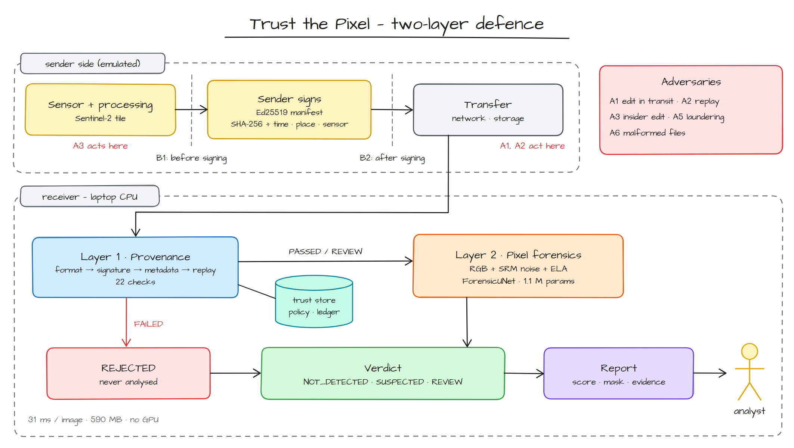
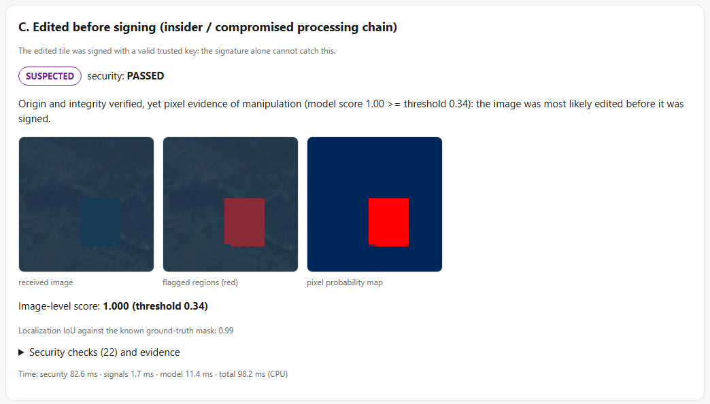

# Trust the Pixel (TSYP14 Track 3)

A verifiable, laptop-only defence for Earth-observation imagery. It answers one question: **can an analyst trust that this image shows what the sensor saw?**

Two independent layers work together:

1. **Provenance (layer 1).** The sender signs a manifest that holds the image's SHA-256 hash and its metadata (Ed25519). The receiver runs 22 checks in a fixed order: format, signature and hash, metadata plausibility, replay. Anything that fails is rejected before a model or an analyst sees it.
2. **Pixel forensics (layer 2).** A signature cannot see an edit made *before* signing, for example by an insider or a compromised processing chain. A small U-Net (ForensicUNet) looks at the pixels themselves, through RGB, SRM noise residuals and Error Level Analysis. It returns an image score and a mask of where the image looks edited.



A detailed version with the file behind each step is in [docs/figures/architecture.png](docs/figures/architecture.png).

## Results at a glance

Real Sentinel-2 tiles from EuroSAT RGB, synthetic edits with exact masks, 5,000 source tiles split by tile (no leakage), seed 0. Full tables with 95% confidence intervals: [docs/results.md](docs/results.md).

| Required metric | Result |
|---|---|
| Detection quality | AUC 0.921; edits seen in training detected at 93.6% (normal model); held-out blur 39.9% |
| False alarms | 1.4% of authentic test images (14 of 1,000), threshold fixed on validation |
| Latency | 31 ms per 64×64 image end to end on a laptop CPU (32 images/s); 83 ms when files are read from disk for the first time |
| Memory | 590 MB peak for the whole process; model file 4.3 MB (1.09 M parameters) |
| Security overhead | Layer 1 takes 21 ms of the 31 ms (68%) on these small tiles |
| Provenance tests | 53/53 on real EuroSAT tiles: our 13 attack scenes, 35 edge cases, 5 invariants; 17/17 injected bugs caught |
| Evasion (laundering) | Robust model with the far5 threshold detects 40–57% of edits after JPEG, resampling, noise or blur, with 1–16% false alarms |

Hardware cost: none. Everything runs on a CPU; no GPU or hardware trust anchor is needed.

## Quick start

Tested on Windows 11 with Python 3.13 and PyTorch 2.11 (CPU).

```bash
python -m pip install -r requirements.txt
python -m pytest -q                          # 78 tests, about 1-2 minutes
```

Download **EuroSAT RGB** (`EuroSAT_RGB.zip`, MIT licence) from [Zenodo record 7711810](https://zenodo.org/records/7711810) and unzip it so that the class folders sit in `data/raw/eurosat/EuroSAT_RGB/` (`AnnualCrop/`, `Forest/`, ...). Then run, from the repository root:

| Step | Command | Time on a laptop CPU |
|---|---|---|
| 1. Build the tampered dataset | `python -m src.preprocessing.build_tampered_eurosat --n_sources 5000` | under 1 min |
| 2. Train ForensicUNet | `python -m src.models.train_forensic` | about 1 h |
| 3. Train the robust model | `python -m src.models.train_forensic --robust` | about 1 h |
| 4. Evasion test, normal model | `python -m src.models.evaluate_evasion` | 2-3 min |
| 5. Evasion test, robust model, 5% false-alarm cap | `python -m src.models.evaluate_evasion --model outputs/forensic_unet_robust.pt --out outputs/evasion_results_robust.json --calibration far5` | 2-3 min |
| 6. Two-layer demo (4 scenarios) | `python -m src.pipeline.demo --model outputs/forensic_unet_robust_far5.pt` | seconds |
| 7. Laptop benchmark | `python -m src.pipeline.benchmark --model outputs/forensic_unet_robust_far5.pt` | under 1 min |
| 8. Figures for the docs | `python -m src.reporting.make_figures` | under 1 min |

Step 5 also writes `outputs/forensic_unet_robust_far5.pt`, the deployed model. Step 6 writes `outputs/demo/index.html`; open it in a browser. All results go to `outputs/*.json`.

Analyse one signed image with both layers:

```bash
python -m src.pipeline.analyze --image <image> --manifest <image_id>.manifest.json --config-dir <folder with trusted_keys.json, policy.json, ledger.json> --model outputs/forensic_unet_robust_far5.pt --out <report folder>
```

Run the provenance test suites (from `src/security/`):

```bash
python run_security_cases.py          # 13 attack scenes + 35 edge cases + 5 invariants, on real EuroSAT tiles
python tools/mutation_check.py         # optional: 17 copies of the module with one bug each must all be caught
```

The test cases in `src/security/test_data/` are already built. To rebuild them from EuroSAT, run `python -m src.security.generate_eurosat_scenes` from the repository root.

## The demo

`src/pipeline/demo.py` takes one EuroSAT test tile and plays the four situations the system must handle:

| Scenario | What happens | Verdict |
|---|---|---|
| A. Authentic image, signed by the trusted sender | Both layers pass | NOT_DETECTED |
| B. Image edited in transit, after signing | Hash no longer matches the signed manifest | REJECTED (`HASH_MISMATCH`) |
| C. Image edited before signing (insider) | Signature is valid; the detector finds the edit and draws its mask (IoU 0.99) | SUSPECTED |
| D. Image A sent again | Same ID and same bytes already in the ledger | REJECTED (`REPLAY_ID`, `REPLAY_CONTENT`) |



## Repository layout

```
src/
  security/      layer 1: security_assessment.py (22 checks), test generators, runner, test data, beginner web page
  forensics/     signals.py (SRM residuals, ELA), evasion.py (laundering operations)
  models/        forensic_unet.py, train_forensic.py, evaluate_evasion.py, evaluation.py
  preprocessing/ build_tampered_eurosat.py, tamper.py (splice, copy-move, colour shift, blur, with exact masks)
  pipeline/      sender.py (emulated signer), analyze.py (both layers + verdict + report), demo.py, benchmark.py
  reporting/     make_figures.py (figures in docs/figures/)
  utils/         contracts.py (shared report formats), metrics.py (AUC, IoU, Dice, false alarms)
tests/           pytest suite (78 tests)
docs/            threat model, detector, results, figures
```

`src/features/`, `src/models/train.py`, `train_eurosat.py`, `classification_head.py` and `localization_head.py` are an earlier **baseline** (frozen ImageNet EfficientNet-B0 with two heads). It is kept for comparison and is **not part of the pipeline**.

`data/` and `outputs/` are not versioned: the dataset is downloaded, and every result is regenerated by the commands above.

## Documentation

| Document | Contents |
|---|---|
| [docs/threat_model.md](docs/threat_model.md) | Segment, trust boundaries, assets, adversaries, STRIDE table, residual risks |
| [docs/detector.md](docs/detector.md) | Signal processing, ForensicUNet, data protocol, evasion scenario, robust training |
| [docs/results.md](docs/results.md) | All measured results with confidence intervals and figures |
| [src/security/README.md](src/security/README.md) | Layer 1 interface, every check in order, test data, design choices |
| `src/security/web/index.html` | Beginner guide to the provenance layer (open in a browser) |

## Limits

* The edits are **synthetic** (rectangular splice, copy-move, colour shift, blur). The scores are valid only in that setting; realistic or AI-generated edits were not evaluated.
* The held-out edit (blur) is detected in fewer than 40% of cases: generalisation to unseen edits is the main open problem.
* After strong JPEG recompression or resampling, the robust model flags 10-16% of authentic images, above the 5% target.
* Results come from one seed. Timings cover 64×64 tiles only.
* Signing uses disposable software keys derived from public labels, as the challenge allows. A deployment would keep the private keys in an HSM or TPM.

## Data credits

EuroSAT (Helber et al., 2019), MIT licence, built from Copernicus Sentinel-2 data.
