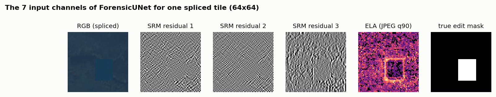
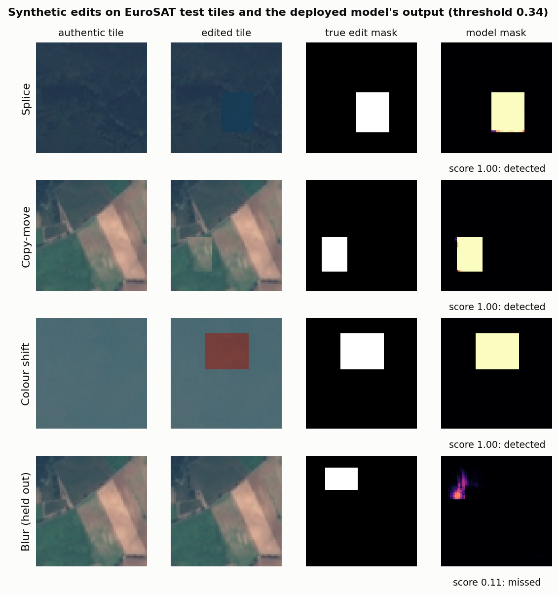
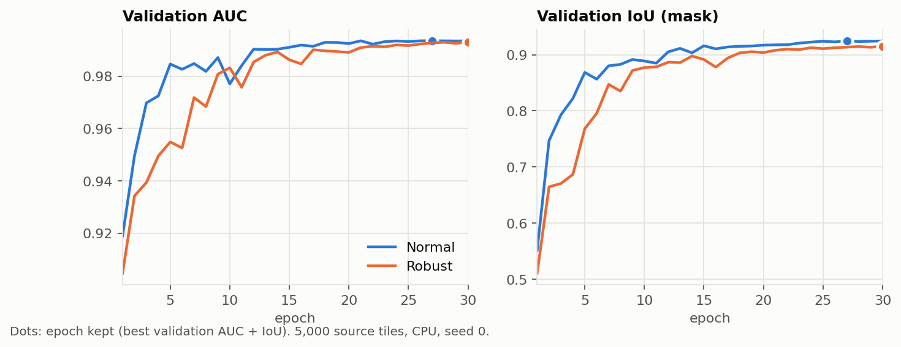

# Pixel-forensics detector (Track 3)

The security module (`src/security/`) proves **where an image comes from and that it was not changed in transit**. It cannot see a manipulation made **before** a trusted sender signed the image. This detector covers that gap: it looks at the pixels themselves.

## Signal processing: forensic traces (`src/forensics/signals.py`)

A local edit leaves traces that the eye does not see but the signal keeps. The detector receives 7 channels at the image's **native resolution** (no upscaling):

| Channels | What they capture |
|---|---|
| R, G, B | image content (centred and scaled) |
| 3 SRM noise residuals | high-pass filters that remove the content and keep the noise texture of the sensor and of the compression (Fridrich & Kodovsky 2012; used for manipulation detection by Zhou et al., CVPR 2018). A pasted or smoothed area has a different noise texture. |
| ELA map | Error Level Analysis (the technique behind Forensically, listed in the official resources): the image is recompressed as JPEG q90; regions with a different compression history react differently. |



In this example the pasted square is almost invisible in RGB, while the ELA map outlines it clearly: the square comes from another tile with a different compression history. These maps are **inputs**, not proof.

## Model: `ForensicUNet` (`src/models/forensic_unet.py`)

A light encoder-decoder (U-Net, Ronneberger et al. 2015) with 1,085,932 parameters (4.3 MB), two outputs:

* a **pixel-level mask** (localization head): where the image looks manipulated;
* an **image-level score** (classification head), computed from the global context and the mask statistics.

It is trained and runs on a CPU. Images of any size are cut into 64×64 tiles (`src/pipeline/analyze.py`): the image score is the **maximum** over tiles, and the mask is the average of the overlapping tile masks. Outputs follow the shared contracts D and E (`src/utils/contracts.py`). Without a validated threshold, no decision is returned, only scores. The report page draws the flagged regions only when the image score reaches the threshold, so it never shows red areas on an image it judged clean; the JSON report keeps the raw mask.

**Why not a classification network such as EfficientNet or ResNet?** Networks pretrained on ImageNet describe *what* is in an image; manipulation shows up in noise and compression statistics that they discard. They also give a single label, not a mask. An earlier baseline of this kind (frozen EfficientNet-B0 with two heads, `src/models/train_eurosat.py`) is kept in the repository for comparison but is not part of the pipeline.

## Data and protocol

* **EuroSAT RGB** (official reference dataset for Track 3), real Sentinel-2 tiles of 64×64 pixels: **5,000 source tiles** drawn at random (seed 0) from the 27,000. EuroSAT has no manipulation labels, so we create the manipulated copies ourselves, with **exact masks** (`src/preprocessing/tamper.py`): `splice`, `copy_move`, `color_shift`, `blur`. Each source tile gives one authentic image and one edited copy (two for test tiles, which also get a `blur` copy): 11,000 images in total.
* **No leakage**: a source tile and all its copies go to the same split (train 60 %, validation 20 %, test 20 %). Checked on the built dataset: no tile appears in two splits.
* **Held-out attack**: `blur` never appears in training or validation, only in the test. This simulates an attack the jury has not shown us.
* **Threshold** chosen on validation only, then applied unchanged to the test:
  * `clean` (default of `train_forensic`): best F1 on clean validation images;
  * `far5` (deployed model, `evaluate_evasion --calibration far5`): the lowest threshold that keeps false alarms at or below 5 % on validation images, clean and randomly laundered. It is saved with the weights in `outputs/forensic_unet_robust_far5.pt`.
* The checkpoint kept is the epoch with the best validation AUC + IoU (out of 30).
* Seeds are fixed. Every run writes its full results, including the training history, to `outputs/*.json`.



## Adversarial validation (`src/forensics/evasion.py`, `src/models/evaluate_evasion.py`)

An attacker who knows the detector "launders" the image after editing it. Our standard evasion scenario applies each operation to **all** test images (authentic and manipulated), with the threshold fixed beforehand:

* JPEG recompression (q90, q75, q60);
* resampling (×0.75, ×0.5);
* Gaussian noise (σ 2, 5);
* Gaussian blur (r 0.6, 1.0);
* resampling + JPEG chain;
* **adaptive attack**: splices with feathered borders.

**Response**: robust training (`--robust`), where half of each training batch is laundered at random (JPEG 60-95, resampling 0.5-0.9, noise 1-5, blur 0.3-1.0, resampling + JPEG), plus the `far5` threshold above. The evaluation reports detection, false alarms and IoU for each operation, before and after this response.

## Results (5,000 source tiles, seed 0)

| | Normal model | Robust model |
|---|---|---|
| Threshold (clean calibration) | 0.45 | 0.29 |
| False alarms, clean test (1,000 authentic) | 1.4 % | 2.6 % |
| Edited images detected (2,000) | 66.8 % | 66.2 % |
| AUC / IoU | 0.921 / 0.677 | 0.902 / 0.657 |
| Seen edits detected (splice, copy-move, colour shift) | 93.6 % | 94.7 % |
| Held-out blur detected | 39.9 % | 37.8 % |

Under laundering, the normal model collapses (AUC 0.48 after ×0.5 resampling; up to 18 % false alarms after JPEG), while the robust model with the far5 threshold keeps AUC between 0.68 and 0.85 and detects 40-57 % of edits, with 1-16 % false alarms. Full tables, confidence intervals and figures: [results.md](results.md).



Validation AUC reaches 0.99 because validation holds only the three edits seen in training; the test AUC (0.92) is lower because it includes the held-out blur.

## Commands

```bash
python -m src.preprocessing.build_tampered_eurosat --n_sources 5000
python -m src.models.train_forensic                      # ForensicUNet (RGB + SRM + ELA)
python -m src.models.evaluate_evasion                    # evasion table for the standard model
python -m src.models.train_forensic --robust             # response: robust training
python -m src.models.evaluate_evasion --model outputs/forensic_unet_robust.pt --out outputs/evasion_results_robust.json --calibration far5
python -m src.models.train_eurosat                       # optional baseline: frozen ImageNet EfficientNet-B0 + heads
```

## Limits

* The manipulations are **synthetic** (rectangular regions). The scores are valid only in this setting. They say nothing about AI-generated imagery or carefully crafted edits.
* EuroSAT has no scene identifier: neighbouring tiles of one Sentinel-2 scene can fall into different splits, so scores may be slightly optimistic.
* Generalization to an **unseen attack** (held-out `blur`) is the main open problem. It is reported, not hidden.
* The robust training uses the same laundering families as the evasion test, so the evasion results measure robustness to *known* laundering.
* Because the image score is a maximum over 64×64 tiles, the false-alarm rate of large images will be higher than on single tiles; it has not been measured yet.
* One seed; a model score is never proof of authenticity or manipulation.
