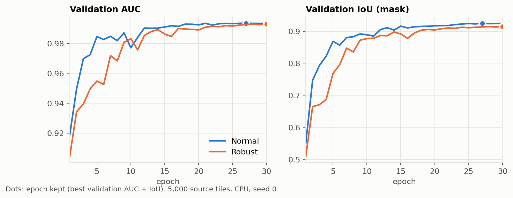
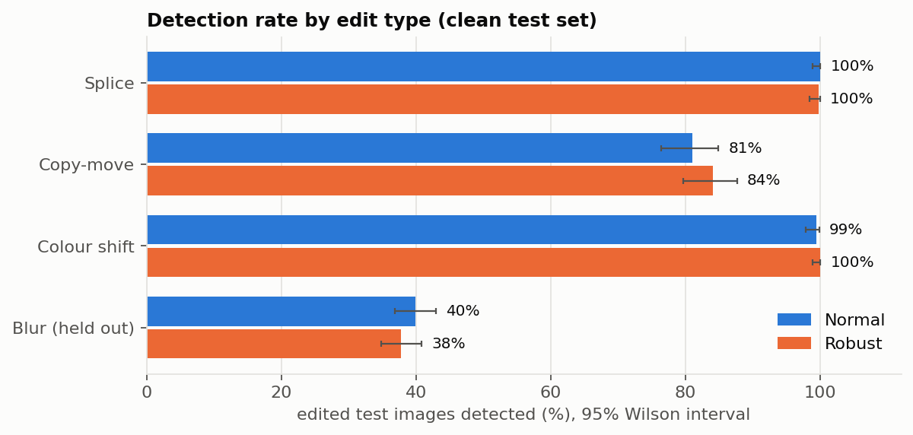
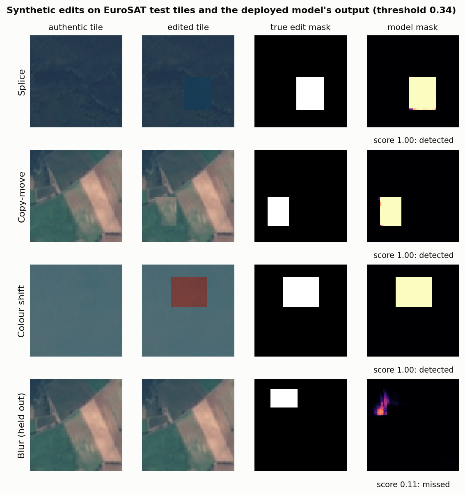
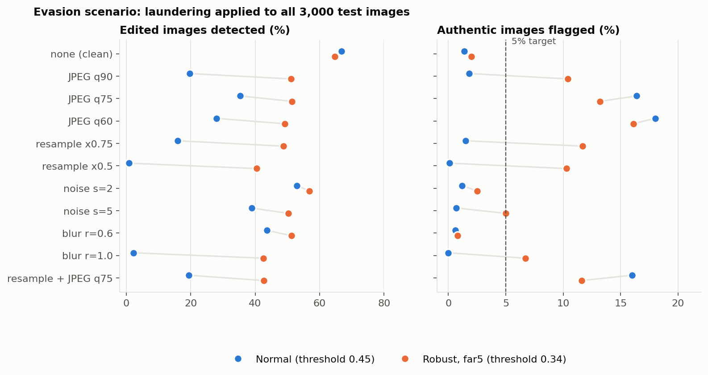
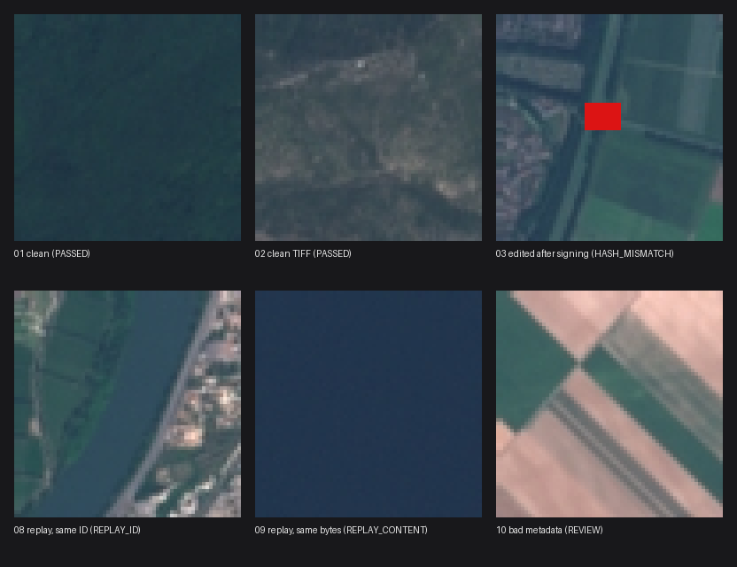
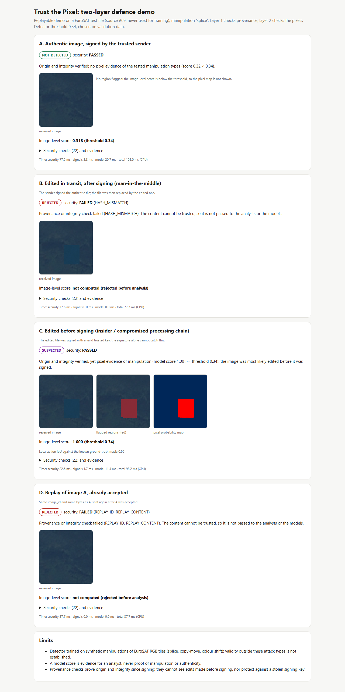
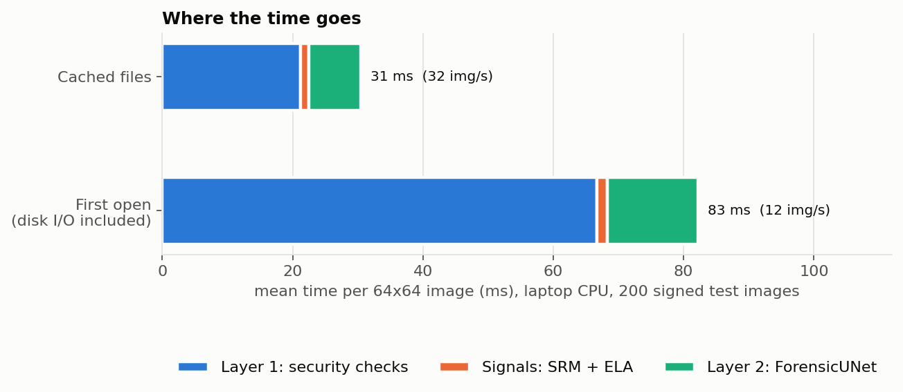

# Results

All numbers below are produced by the repository commands (see the [README](../README.md)) and read from `outputs/*.json`. The figures are rebuilt by `python -m src.reporting.make_figures`. Square brackets give 95 % Wilson confidence intervals.

**Scope.** The edits are synthetic (rectangular splice, copy-move, colour shift, blur) on real Sentinel-2 tiles from EuroSAT RGB. The results are valid in this setting only; realistic or AI-generated edits were not evaluated.

## 1. Setup

| Item | Value |
|---|---|
| Data | EuroSAT RGB (Zenodo record 7711810, MIT licence; Copernicus Sentinel-2 imagery), 64×64 tiles |
| Source tiles | 5,000 of 27,000, drawn with seed 0 |
| Images | 11,000: train 6,000 / validation 2,000 / test 3,000, split by source tile (no tile in two splits, checked) |
| Edits in train and validation | splice, copy-move, colour shift (one edited copy per tile) |
| Held-out edit, test only | blur |
| Test set | 1,000 authentic, 2,000 edited (339 splice, 326 copy-move, 335 colour shift, 1,000 blur) |
| Model | ForensicUNet, 7 channels (RGB + 3 SRM residuals + ELA), 1,085,932 parameters, 4.3 MB |
| Training | 30 epochs on CPU, best epoch kept on validation AUC + IoU (normal: 27, robust: 30); about one hour per model |
| Software and hardware | Python 3.13.5, PyTorch 2.11 (CPU, 10 threads), laptop with an Intel Core i7-12650H and 32 GB RAM; GPU not used |

## 2. Detector on the clean test set

Threshold chosen on validation only (best F1), then applied unchanged to the test set.

| Model | Threshold | False alarms (of 1,000 authentic) | Edited caught (of 2,000) | Recall at 5 % FAR | Precision | AUC | IoU | Wrong pixels on authentic |
|---|---|---|---|---|---|---|---|---|
| Normal | 0.45 | 1.4 % [0.8 %–2.3 %] | 66.8 % [64.7 %–68.8 %] | 0.715 | 0.990 | 0.921 | 0.677 | 0.2 % |
| Robust | 0.29 | 2.6 % [1.8 %–3.8 %] | 66.2 % [64.1 %–68.3 %] | 0.675 | 0.981 | 0.902 | 0.657 | 0.4 % |

| Edit | Seen in training | n | Normal AUC | Normal caught | Normal IoU | Robust AUC | Robust caught | Robust IoU |
|---|---|---|---|---|---|---|---|---|
| splice | yes | 339 | 1.000 | 100.0 % [98.9 %–100.0 %] | 0.994 | 0.999 | 99.7 % [98.3 %–99.9 %] | 0.988 |
| colour shift | yes | 335 | 1.000 | 99.4 % [97.8 %–99.8 %] | 0.990 | 1.000 | 100.0 % [98.9 %–100.0 %] | 0.990 |
| copy-move | yes | 326 | 0.973 | 81.0 % [76.4 %–84.9 %] | 0.770 | 0.977 | 84.0 % [79.7 %–87.6 %] | 0.777 |
| blur | **no** | 1,000 | 0.850 | 39.9 % [36.9 %–43.0 %] | 0.434 | 0.812 | 37.8 % [34.8 %–40.8 %] | 0.394 |

Edits seen in training, together: normal 93.6 % [91.9 %–95.0 %], robust 94.7 % [93.1 %–95.9 %].

## 3. Evasion scenario (laundering)

Each laundering operation is applied to **all** 3,000 test images, authentic and edited. Normal model: threshold 0.45 from clean validation. Robust model: threshold 0.342 (`far5`), the lowest that keeps false alarms at or below 5 % on clean plus randomly laundered validation images. The last two rows use the 1,000 authentic and 339 splice test images only.

| Laundering | Normal AUC | Normal caught | Normal false alarms | Robust AUC | Robust caught | Robust false alarms |
|---|---|---|---|---|---|---|
| none (clean) | 0.921 | 66.8 % | 1.4 % [0.8 %–2.3 %] | 0.902 | 64.7 % | 2.0 % [1.3 %–3.1 %] |
| JPEG q90 | 0.571 | 19.7 % | 1.8 % [1.1 %–2.8 %] | 0.755 | 51.2 % | 10.4 % [8.7 %–12.4 %] |
| JPEG q75 | 0.615 | 35.4 % | 16.4 % [14.2 %–18.8 %] | 0.735 | 51.4 % | 13.2 % [11.2 %–15.4 %] |
| JPEG q60 | 0.560 | 28.0 % | 18.0 % [15.7 %–20.5 %] | 0.714 | 49.2 % | 16.1 % [14.0 %–18.5 %] |
| resample ×0.75 | 0.595 | 15.9 % | 1.5 % [0.9 %–2.5 %] | 0.715 | 48.8 % | 11.7 % [9.9 %–13.8 %] |
| resample ×0.5 | 0.476 | 0.8 % | 0.1 % [0.0 %–0.6 %] | 0.679 | 40.5 % | 10.3 % [8.6 %–12.3 %] |
| Gaussian noise σ2 | 0.855 | 53.0 % | 1.2 % [0.7 %–2.1 %] | 0.852 | 56.8 % | 2.5 % [1.7 %–3.7 %] |
| Gaussian noise σ5 | 0.737 | 38.9 % | 0.7 % [0.3 %–1.4 %] | 0.781 | 50.3 % | 5.0 % [3.8 %–6.5 %] |
| Gaussian blur r0.6 | 0.801 | 43.7 % | 0.6 % [0.3 %–1.3 %] | 0.835 | 51.3 % | 0.8 % [0.4 %–1.6 %] |
| Gaussian blur r1.0 | 0.490 | 2.2 % | 0.0 % [0.0 %–0.4 %] | 0.710 | 42.6 % | 6.7 % [5.3 %–8.4 %] |
| resample ×0.75 + JPEG q75 | 0.507 | 19.4 % | 16.0 % [13.9 %–18.4 %] | 0.687 | 42.8 % | 11.6 % [9.8 %–13.7 %] |
| feathered splice (adaptive) | 0.959 | 88.2 % | 1.4 % | 0.960 | 90.3 % | 2.0 % |
| plain splice (reference) | 1.000 | 100.0 % | 1.4 % | 0.999 | 99.7 % | 2.0 % |

**Reading.** Without the response, laundering blinds the detector: its AUC falls to chance after strong resampling or blur (0.48-0.49), and JPEG recompression makes it flag up to 18 % of authentic images. With robust training and the far5 threshold, AUC stays between 0.68 and 0.85 and 40-57 % of edits are still detected. The price is false alarms of 10-16 % after JPEG or resampling, above the 5 % target, because the cap applies to a validation mix where clean images dominate. The robust training uses the same laundering families as this test, so these numbers measure robustness to *known* laundering.

## 4. Provenance layer

The 13 attack scenes and their answer keys come from our own layer 1 specification, written before the code (the challenge documents do not detail the common standard scenario). Every test picture is a real EuroSAT Sentinel-2 tile (41 tiles from all 10 classes, enlarged ×4 by pixel repetition), except the files that are deliberately not pictures: an empty file, a text file renamed `.png`, random bytes, a decompression-bomb header and a 7000×6000 bilevel PNG.

| Test set | Result |
|---|---|
| 13 attack scenes (`src/security/test_data/scenes/`) | 13 / 13 |
| 35 edge cases for the checks no scene covers (`src/security/test_data/edge_cases/`) | 35 / 35 |
| 5 invariants (never reads the answer key, never modifies the ledger, records only after PASSED, deterministic, refuses private keys) | 5 / 5 |
| Independent script comparing all 7 tested fields of every case with its answer key | 48 / 48 |
| 13 reference samples from a second, separate generator written with the specification (synthetic pictures, demo keys) | 13 / 13 (+ 5 / 5 invariants) |
| `tools/mutation_check.py`: single-bug copies of the module | 17 / 17 caught |

Every one of the 22 reason codes in the specification is exercised by at least one case.

## 5. End-to-end demo

`python -m src.pipeline.demo --model outputs/forensic_unet_robust_far5.pt`, on EuroSAT test tile #69 with a splice, threshold 0.342:

| Scenario | Layer 1 | Codes | Verdict | Score | Mask IoU |
|---|---|---|---|---|---|
| A. authentic, signed | PASSED | — | NOT_DETECTED | 0.318 | — |
| B. edited in transit | FAILED | HASH_MISMATCH | REJECTED | — | — |
| C. edited before signing | PASSED | — | SUSPECTED | 1.000 | 0.99 |
| D. replay of A | FAILED | REPLAY_ID, REPLAY_CONTENT | REJECTED | — | — |

## 6. Feasibility on a laptop CPU

200 signed 64×64 test images, laptop on mains power, Windows Balanced power plan, deployed far5 model.

| Per image | Cached files, mean / p95 | First open, mean / p95 |
|---|---|---|
| Layer 1 security checks | 21.2 / 22.0 ms | 66.7 / 99.9 ms |
| Forensic signals (SRM + ELA) | 1.4 / 2.0 ms | 1.7 / 3.3 ms |
| ForensicUNet | 7.9 / 9.1 ms | 13.9 / 36.3 ms |
| Total | 31.0 / 32.4 ms | 83.1 / 120.5 ms |
| Throughput | 32 images/s | 12 images/s |
| Security share of time | 68 % | 80 % |

Memory: 526 MB at start, 541 MB after loading the model, 590 MB peak (sampled). Model file 4.3 MB. Hardware cost: none.

The security share is high because the tiles are tiny: layer 1 hashes and verifies once per file, while detector cost grows with the number of 64×64 tiles, so the share falls for full-size products. Only 64×64 tiles were measured.

## 7. Effect of more data (1,200 vs 5,000 source tiles)

The same pipeline was first run on 1,200 source tiles (240 authentic test images), then on 5,000.

| Metric | 1,200 tiles | 5,000 tiles |
|---|---|---|
| Normal: false alarms, clean test | 5.0 % | 1.4 % |
| Normal: AUC / IoU | 0.872 / 0.575 | 0.921 / 0.677 |
| Normal: held-out blur caught | 35.0 % | 39.9 % |
| Robust: edited caught, clean test | 49.6 % | 66.2 % |
| Robust: copy-move / blur caught | 55.6 % / 14.2 % | 84.0 % / 37.8 % |
| Robust: AUC | 0.817 | 0.902 |
| Normal under laundering: worst false alarms | 46.7 % | 18.0 % |
| Robust far5 under laundering: worst AUC | 0.634 | 0.679 |
| Robust far5 under laundering: worst false alarms | 15.8 % | 16.1 % |

More data helps every detection metric and shrinks the confidence intervals (about ±1 point instead of ±3 on the false-alarm rate). It does not lower the robust model's false alarms after laundering.

## 8. Limits

* Synthetic rectangular edits on EuroSAT tiles; nothing is claimed for realistic or AI-generated manipulations.
* One seed. With 1,000 authentic test images, a false-alarm rate near 2 % carries about ±1 point of uncertainty.
* The held-out blur is the weakest edit: under 40 % caught by both models.
* Robust results use laundering families seen in training; unseen laundering is not evaluated.
* After JPEG or resampling, the robust model's false alarms are 10-16 %, above the 5 % target.
* Timings cover 64×64 tiles only. Because the image score is the maximum over tiles, the false-alarm rate of large images is expected to be higher and has not been measured.
* Neighbouring EuroSAT tiles from one Sentinel-2 scene may fall in different splits, so scores may be slightly optimistic.
